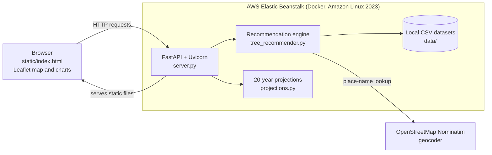

# Green Lungs: Which tree should go here?

A tree-planting recommendation web app for Delhi, built for **Environmental Hacks by AWS × WeMakeDevs (Air Track)**.

Search for a place (or enter coordinates) and Green Lungs matches it to the nearest study site, reads that site's seasonal air-quality, heat and water conditions, ranks tree species that suit those conditions, assigns species to the site's available planting patches, and shows the result on an interactive satellite map together with 20-year comparison charts.

| | |
|---|---|
| **Live app** | http://greenlungs-env.eba-npiprwiw.ap-southeast-2.elasticbeanstalk.com/ |
| **API docs (Swagger UI)** | http://greenlungs-env.eba-npiprwiw.ap-southeast-2.elasticbeanstalk.com/docs |
| **Health check** | http://greenlungs-env.eba-npiprwiw.ap-southeast-2.elasticbeanstalk.com/api/health |
| **Hosting** | AWS Elastic Beanstalk (Docker platform on Amazon Linux 2023) |

---

## Table of contents

1. [The problem and the idea](#the-problem-and-the-idea)
2. [How it works](#how-it-works)
3. [The recommendation engine explained](#the-recommendation-engine-explained)
4. [Features](#features)
5. [Architecture and project structure](#architecture-and-project-structure)
6. [Tech stack](#tech-stack)
7. [Run locally](#run-locally)
8. [API reference](#api-reference)
9. [Deploying on AWS Elastic Beanstalk](#deploying-on-aws-elastic-beanstalk)
10. [AWS services: what is and is not used](#aws-services-what-is-and-is-not-used)
11. [Data, limitations and responsible use](#data-limitations-and-responsible-use)
12. [Adding a study site](#adding-a-study-site)
13. [Future improvements](#future-improvements)
14. [Contributors and acknowledgements](#contributors-and-acknowledgements)

---

## The problem and the idea

Delhi has serious particulate pollution, strong summer heat, a short intense monsoon and limited space for new trees. "Plant more trees" is easy advice, but the choice of species matters: some capture more particulate matter, some give better summer shade, some need far more water, some tolerate waterlogging or polluted air better, and some emit compounds that can contribute to ozone formation.

Green Lungs helps with the question **"which tree should go here?"** by turning a site's environmental data and a species table into a ranked, explainable recommendation, and then into a concrete planting plan for the free spaces ("patches") at that site.

It could be useful to residents' associations, campus and institutional green-space teams, NGOs, and anyone exploring how location-specific conditions change which species make sense. It is a decision-support prototype, not a replacement for a site survey or an arborist's advice.

## How it works

1. **Search** for a place name, or enter latitude and longitude.
2. **Match** the input to the nearest available study site. Only points within **5 km** of a study site are supported.
3. **Analyse** that site's hourly environmental record, summarised per season, and derive five environmental needs: particle pollution, heat stress, ozone sensitivity, water scarcity and waterlogging risk.
4. **Rank** tree species with a transparent weighted score (details below).
5. **Allocate** species to the site's planting patches, subject to site type, width, area, spacing and a species-diversity cap.
6. **Show** the matched site, the planting patches and the recommendation on the map, and compare projected growth, survival, PM2.5 impact, shade and cost over 20 years.

> **Scope note:** Green Lungs does not provide citywide, building-level or street-level measurements. Each recommendation is based on the environmental record of the matched study site, which is used as a proxy for nearby locations.

---

## The recommendation engine explained

The engine lives in [`tree_recommender.py`](tree_recommender.py) and the projections in [`projections.py`](projections.py). There is **no machine-learning model** and no trained predictor: everything is explicit arithmetic over the CSV data, so every score can be traced and every weight can be changed.

### 1. Seasonal baseline

For the matched site, the hourly time series is grouped into four Delhi-style seasons:

| Season | Months |
|---|---|
| Winter | Nov, Dec, Jan, Feb |
| Summer | Mar, Apr, May, Jun |
| Monsoon | Jul, Aug, Sep |
| Post-monsoon | Oct |

For each season and for the year overall, the engine computes mean values, the 90th percentile of PM2.5, PM10, apparent temperature and vapour pressure deficit, the fraction of hours above reference limits (approximate Indian 24-hour standards for PM2.5, PM10, NO₂, SO₂, ozone and CO), and the fraction of hours with apparent temperature at or above 35 °C. It also computes annual and monsoon rainfall.

Before this, environment rows with unreadable timestamps are dropped, gaps of up to 6 hours are interpolated, and rows still missing a core column are dropped.

### 2. Environmental needs (each scaled 0 to 1)

| Need | How it is derived |
|---|---|
| `pm_need` | 60% PM2.5 annual mean ÷ 120, plus 40% PM10 annual mean ÷ 250 (each capped at 1) |
| `heat_need` | Highest seasonal heat stress, where heat stress = (90th-percentile apparent temperature − 30) ÷ 15 |
| `voc_sensitivity` | Average of ozone ÷ 100 and NO₂ ÷ 80, used to penalise species with high BVOC emissions |
| `water_scarcity` | Average of vapour pressure deficit ÷ 2.5 and (1 − annual rainfall ÷ 1200 mm) |
| `waterlogging_risk` | Monsoon rainfall ÷ 600 mm |

### 3. Species score (0 to 100)

Every species gets a weighted score. The default weights are in `DEFAULT_WEIGHTS`:

| Component | Weight | What it captures |
|---|---|---|
| Benefit | 0.40 | Particulate capture and cooling, blended according to the site's `pm_need` and `heat_need`, and scaled by growth speed |
| Resilience | 0.25 | Tolerance to heat, drought, waterlogging and pollution, plus 10-year survival, each weighted by how much the site needs it |
| Local fit | 0.15 | Local suitability score (80%) and whether the species is on the Delhi native list (20%) |
| Water | 0.10 | Lower irrigation need scores higher, and matters more when `water_scarcity` is high |
| Cost | 0.10 | Lower 7-year total cost scores higher |
| BVOC penalty | −0.15 | Subtracted: species with high BVOC emissions are penalised more where `voc_sensitivity` is high |

Details worth knowing:

- **Particulate benefit** uses each species' PM2.5 and PM10 removal figures, rescaled to the site's local seasonal concentrations and to whether the tree is in leaf (winter versus March to October), then reduced by a resuspension fraction.
- **Cooling benefit** combines air cooling, mean radiant temperature reduction, surface temperature reduction and shade effectiveness, weighted by each season's heat stress and leaf-on fraction.
- Several indices are **min-max normalised across the species table**, so scores are relative rankings within the table, not absolute ratings.
- Each recommended species comes with plain-language reasons (for example "heat tolerant" or "tolerates monsoon waterlogging") and a caution when BVOC emissions matter locally.

### 4. Planting-patch allocation

Patches are processed from largest to smallest. For each patch, a species is a candidate only if:

- it is suitable for the patch's **site type** (verge, median, park edge or institutional, matched from keywords in the `site_type` text);
- the patch's maximum width is at least the species' **minimum site width** (when width data exists);
- the patch area is at least the species' **planting area per tree**.

The number of trees is `floor(area ÷ planting area per tree)`, further limited by `length ÷ spacing` for linear patches (verges, medians, strips) and by `est_trees` if the patch provides one. The candidate's score is reduced by up to 20% for species with a high root-damage risk on narrow sites, and the best candidate is chosen. Two alternatives are reported per patch.

**Diversity cap:** once at least 30 trees have been planned, the engine prefers candidates that keep any single species at or below 40% of planted trees. This is a best-effort preference: if no candidate satisfies it, the best-scoring candidate is used. A patch where no species fits is reported with a note instead of a recommendation.

### 5. 20-year projections

`projections.py` builds per-tree curves for years 0 to 20 by interpolating columns of the species table:

- **Canopy:** interpolated between the species' canopy fractions at years 1, 3, 5, 10 and 20, never decreasing.
- **Survival:** interpolated between the year 1, 5 and 10 survival values, with year 20 extrapolated from the trend between years 5 and 10, never increasing.
- **PM2.5 removal:** local mature-tree removal × canopy × survival.
- **Shade area:** mature crown area × canopy × survival.
- **Cost:** planting cost in year 0 (sapling, planting, tree guard), then maintenance costs for year 1, year 2, years 3 to 7 and year 8 onwards.

The "totals" series multiply each species' per-tree curve by the number of trees assigned to it in the patch plan.

### What is data-driven, rule-based and synthetic

| Part | Nature |
|---|---|
| Seasonal baseline and needs | **Data-driven**: summary statistics of the site's environmental time series, converted to 0–1 needs by fixed formulas |
| Species ranking | **Rule-based**: weighted formula over species-table attributes; weights are editable |
| Patch allocation | **Rule-based**: greedy, constraint-filtered selection with a diversity preference |
| 20-year growth, survival, impact and cost curves | **Synthetic**: interpolations of species-table values, useful for comparing options, **not validated forecasts** |

---

## Features

- Place-name search (OpenStreetMap Nominatim, with a local CSV cache of past lookups)
- Latitude/longitude input
- Matching to the nearest study site within 5 km, with a warning when the point is far from the matched site
- Seasonal environmental analysis and derived environmental needs
- Ranked species recommendations with a score and reasons
- Per-patch species assignment with tree counts, alternatives and estimated 7-year cost and irrigation
- Plan summary: trees, 7-year cost, estimated PM2.5 capture at maturity and at year 10, crown area, irrigation, trees per species
- Interactive satellite map (Leaflet) showing the matched site and planting patches
- Comparative 20-year charts for canopy, survival, PM2.5 impact, shade and cost
- REST API with interactive documentation at `/docs`

---

## Architecture and project structure



```text
Green-Lungs/
├── server.py              FastAPI app: API routes and static frontend hosting
├── tree_recommender.py    Recommendation engine: matching, baseline, scoring, patch planning, geocoder
├── projections.py         20-year growth / survival / impact / cost curves
├── aws_io.py              Optional S3 data loading and Amazon Location geocoder (off by default)
├── requirements.txt       Python dependencies
├── Dockerfile             Container image definition used for deployment
├── .dockerignore          Files excluded from the Docker build context (see deployment notes)
├── .gitignore
├── static/
│   └── index.html         Frontend (Leaflet map and charts)
└── data/
    ├── locations.csv              One row per study site: location_id, name, lat, lon
    ├── environment_conditions.csv Hourly environmental record per site
    ├── tree_species.csv           One row per species
    ├── planting_patches.csv       Planting patches: patch_id, lat, lon, area_m2, site_type, ...
    └── geocode_cache.csv          Cache of place lookups (optional, created automatically)
```

| File | Purpose |
|---|---|
| `server.py` | Defines `/api/health`, `/api/overview` and `/api/recommend`, enables CORS, assigns species colours and mounts `static/` at `/` |
| `tree_recommender.py` | `RecommendationEngine`: loads and validates the CSVs, geocodes, matches sites, builds baselines, scores species, plans patches, and produces JSON and GeoJSON |
| `projections.py` | `build_projection`: per-species and total 20-year curves returned by the API |
| `aws_io.py` | Chooses the data directory and geocoder at startup. With no environment variables it uses `data/` and Nominatim |
| `Dockerfile` | `python:3.12-slim`, installs `requirements.txt`, copies the project, exposes port 8000, runs `uvicorn server:app --host 0.0.0.0 --port 8000` |

---

## Tech stack

| Layer | Technology |
|---|---|
| Language | Python (Docker image uses 3.12) |
| Backend | FastAPI, Uvicorn |
| Data handling | pandas, NumPy |
| HTTP client (geocoding) | requests |
| AWS SDK | boto3 (imported only if the optional S3 or Amazon Location settings are enabled) |
| Frontend | Leaflet (interactive map), Chart.js (charts), single-page HTML |
| Geocoding | OpenStreetMap Nominatim |
| Packaging and runtime | Docker |
| Hosting | AWS Elastic Beanstalk (Docker platform, Amazon Linux 2023) |

Dependencies are listed without version pins in `requirements.txt`: `fastapi`, `uvicorn[standard]`, `pandas`, `numpy`, `requests`, `boto3`.

---

## Run locally

**Requirements:** Python 3.10 or newer (the code uses `str | None` type syntax). Python 3.12 is recommended because it matches the Docker image.

No configuration or environment variables are needed. The app reads the CSVs in `data/` and uses Nominatim for place-name search (internet access is needed for new place names; coordinates work without it).

### Windows (PowerShell)

```powershell
git clone https://github.com/Vansh-Vaibhav/Green-Lungs.git
cd Green-Lungs
py -3.12 -m venv .venv
.\.venv\Scripts\Activate.ps1
pip install -r requirements.txt
uvicorn server:app --reload --port 8000
```

If activation is blocked, run `Set-ExecutionPolicy -Scope Process -ExecutionPolicy Bypass` first.

### macOS / Linux

```bash
git clone https://github.com/Vansh-Vaibhav/Green-Lungs.git
cd Green-Lungs
python3 -m venv .venv
source .venv/bin/activate
pip install -r requirements.txt
uvicorn server:app --reload --port 8000
```

**Run from the project root** (the folder containing `server.py`, `data/` and `static/`). The server locates `data/` and `static/` relative to `server.py`, and `uvicorn server:app` must be able to import `server` from the current directory.

Then open:

| What | URL |
|---|---|
| Website | http://127.0.0.1:8000/ |
| API docs | http://127.0.0.1:8000/docs |
| Health check | http://127.0.0.1:8000/api/health |

At startup the engine validates the CSVs. A missing file or required column stops the app with a `Data problem:` message naming it. Column names may carry unit suffixes such as `pm2_5 (μg/m³)`; the suffix is stripped on load.

You can also run the engine without the web server:

```bash
python tree_recommender.py "Anand Lok, New Delhi" --data data
```

---

## API reference

Interactive documentation: [`/docs`](http://greenlungs-env.eba-npiprwiw.ap-southeast-2.elasticbeanstalk.com/docs). All three routes below are the only API routes defined in `server.py`; every other path serves the static frontend.

| Method | Path | Purpose |
|---|---|---|
| GET | `/api/health` | Service status and active data source and geocoder |
| GET | `/api/overview` | All study sites and planting patches, for the initial map |
| POST | `/api/recommend` | Recommendation for a place name or a coordinate pair |

### `GET /api/health`

```json
{
  "status": "ok",
  "sites": 3,
  "species": 14,
  "data_source": "local folder",
  "geocoder": "OpenStreetMap Nominatim"
}
```

`sites` and `species` are the counts loaded from the CSVs (the numbers above are illustrative). Live: [`/api/health`](http://greenlungs-env.eba-npiprwiw.ap-southeast-2.elasticbeanstalk.com/api/health).

### `GET /api/overview`

Returns `{"sites": [{"location_id", "name", "lat", "lon"}, ...], "patches": [{"lat", "lon", "area_m2"}, ...]}`.

### `POST /api/recommend`

**Request body (JSON)**

| Field | Type | Notes |
|---|---|---|
| `query` | string, optional | Place name, geocoded with Nominatim |
| `lat`, `lon` | number, optional | Coordinates. If both are given they are used and `query` is ignored |
| `top_k` | integer, optional | Number of ranked species to return. Default 6, clamped to 3–10 |

Provide either `query` or both `lat` and `lon`.

```json
{
  "lat": 28.5575,
  "lon": 77.22,
  "top_k": 6
}
```

or

```json
{
  "query": "Anand Lok, New Delhi",
  "top_k": 6
}
```

**PowerShell**

```powershell
$body = @{ lat = 28.5575; lon = 77.22; top_k = 6 } | ConvertTo-Json
Invoke-RestMethod -Method Post `
  -Uri "http://greenlungs-env.eba-npiprwiw.ap-southeast-2.elasticbeanstalk.com/api/recommend" `
  -ContentType "application/json" -Body $body
```

**curl**

```bash
curl -X POST "http://greenlungs-env.eba-npiprwiw.ap-southeast-2.elasticbeanstalk.com/api/recommend" \
  -H "Content-Type: application/json" \
  -d '{"lat": 28.5575, "lon": 77.22, "top_k": 6}'
```

Replace the host with `http://127.0.0.1:8000` to test a local run.

**Response (top-level keys)**

| Key | Contents |
|---|---|
| `result` | `query`, `input_point`, `matched_location` (with `distance_km`), `baseline` (seasonal statistics, period, rainfall), `needs`, `species_ranking` (score, component indices, local PM removal estimates, reasons), `patch_plan`, `plan_summary`, `warnings` |
| `geojson` | GeoJSON `FeatureCollection` with the query point, matched site and planting patches |
| `table` | Top species with score, PM2.5 removal, cooling, crown area, water use, 10-year survival, 7-year cost and reasons |
| `colors` | Species ID to display colour |
| `projection` | `years` (0–20), per-species curves, and `totals` (annual and cumulative cost, annual and cumulative PM2.5 in kg, shade area in m²) |

**Errors**

| Status | When |
|---|---|
| `422` | The point is more than 5 km from every study site (the message lists the nearest sites), the place name could not be geocoded, or the request body has invalid field types |
| `400` | Neither a place name nor coordinates were provided |
| `502` | The place lookup failed for another reason, such as a geocoder or network problem |

---

## Deploying on AWS Elastic Beanstalk

The application runs on **AWS Elastic Beanstalk** using the **Docker** platform on Amazon Linux 2023. Elastic Beanstalk builds the image from the project's `Dockerfile` and runs the container, which serves FastAPI through Uvicorn on port 8000 (`EXPOSE 8000` in the Dockerfile). The container reads its datasets from the `data/` folder inside the image.

### How the Dockerfile is used

```dockerfile
FROM python:3.12-slim
WORKDIR /app
COPY requirements.txt .
RUN pip install --no-cache-dir -r requirements.txt
COPY . .
EXPOSE 8000
CMD ["uvicorn", "server:app", "--host", "0.0.0.0", "--port", "8000"]
```

`COPY . .` copies everything in the uploaded bundle into the image, so **whatever is in the ZIP is what runs**.

### 1. Prepare the deployment ZIP

The ZIP must contain these items **directly at its root**, not inside an extra parent folder such as `Green-Lungs/`:

```text
greenlungs-deploy.zip
├── Dockerfile
├── server.py
├── tree_recommender.py
├── projections.py
├── aws_io.py
├── requirements.txt
├── data/
└── static/
```

From the project root in PowerShell:

```powershell
Compress-Archive -Force -DestinationPath greenlungs-deploy.zip -Path `
  Dockerfile, server.py, tree_recommender.py, projections.py, aws_io.py, requirements.txt, data, static
```

On macOS or Linux:

```bash
zip -r greenlungs-deploy.zip Dockerfile server.py tree_recommender.py projections.py aws_io.py requirements.txt data static
```

Check the layout before uploading. The first entries must be `Dockerfile`, `server.py` and so on, with no leading folder:

```bash
tar -tf greenlungs-deploy.zip
```

> **Do not include `.dockerignore` in the ZIP.** The repository's `.dockerignore` lists `data/`, which would keep the datasets out of the image and stop the app at startup. The command above leaves it out on purpose. Also leave out `.git`, `.venv`, `.env` and `__pycache__`.

### 2. Upload and deploy

1. Open the **Elastic Beanstalk console** in the region of the environment (the current one is `greenlungs-env` in `ap-southeast-2`).
2. Select the environment and choose **Upload and deploy**.
3. Choose `greenlungs-deploy.zip`.
4. Enter a **new, unique version label** (for example `v2` or a date-based name). Reusing an existing label is rejected.
5. Choose **Deploy** and wait for the environment to finish updating.

For a first-time setup, create an application and environment with the **Docker** platform (Amazon Linux 2023 branch), upload the same ZIP as the application code, and use the same steps afterwards.

### 3. Verify

- The environment health in the console should return to **Ok**.
- Open `/api/health` and confirm `"status": "ok"`, non-zero `sites` and `species`, and `"data_source": "local folder"`:
  http://greenlungs-env.eba-npiprwiw.ap-southeast-2.elasticbeanstalk.com/api/health
- Open the site and run a search, and open `/docs`.

If the environment turns **Degraded** or **Severe**, request the environment logs from the console. The usual causes are a ZIP with a nested parent folder, missing `data/` or `static/`, a CSV with a missing required column (the app exits with `Data problem: ...`), or a dependency imported in code but missing from `requirements.txt`.

### Keeping configuration and code consistent

- Anything the code imports must be in `requirements.txt`, because the image installs only what is listed.
- Any change to the CSV schema must match the required columns in `tree_recommender.py`.
- Local runs and the container should use compatible Python versions (the image uses 3.12).

---

## AWS services: what is and is not used

| Item | Status |
|---|---|
| **AWS Elastic Beanstalk** | **Used.** Hosts the application (Docker platform, Amazon Linux 2023) |
| **Docker** | **Used.** Packages and runs the application |
| Datasets | Read from the local `data/` folder baked into the image |
| Geocoding | OpenStreetMap Nominatim |
| Logging | The app writes standard Python log lines (one per search) to the container output; no custom logging integration is configured |

**Optional code paths, not enabled in the current deployment.** `aws_io.py` contains two opt-in features that stay off unless environment variables are set:

| Environment variable | Effect if set |
|---|---|
| `DATA_BUCKET` (optional `DATA_PREFIX`, `AWS_REGION`) | Downloads the CSVs from an Amazon S3 bucket at startup instead of reading `data/` |
| `GEOCODER=amazon` (optional `AWS_REGION`, `BIAS_LON`, `BIAS_LAT`) | Uses Amazon Location Service for place search, with Nominatim as fallback |

The current deployment sets neither, so `/api/health` reports `"data_source": "local folder"` and `"geocoder": "OpenStreetMap Nominatim"`. Using these paths would also require an S3 bucket and IAM permissions that are not part of the current setup. The project does not currently use Amazon ECR, App Runner, ECS or a dedicated CloudWatch integration.

---

## Data, limitations and responsible use

### Data

The environmental time series covers 2024 to 2026 and is organised per study site. The project acknowledges these data providers:

- [OpenAQ](https://openaq.org/) (v3), for air-quality observations
- [Open-Meteo](https://open-meteo.com/), for weather and air-quality data
- [Copernicus Atmosphere Monitoring Service (CAMS)](https://atmosphere.copernicus.eu/), European Earth observation data
- [OpenStreetMap](https://www.openstreetmap.org/) contributors (including the Nominatim geocoder and map tiles)

The species table (`tree_species.csv`) and the planting-patch table (`planting_patches.csv`) are project datasets; their per-column sources are not documented in this repository.

| File | Required columns |
|---|---|
| `locations.csv` | `location_id`, `name`, `lat`, `lon` |
| `environment_conditions.csv` | `location_id`, `time`, `pm2_5`, `pm10`, `nitrogen_dioxide`, `ozone`, `apparent_temperature`, `temperature_2m`, `relative_humidity_2m`, `precipitation`, `vapour_pressure_deficit` |
| `tree_species.csv` | `species_id`, `common_name`, `scientific_name`, plus the trait, cost and suitability columns listed in `SPECIES_REQUIRED` in `tree_recommender.py` |
| `planting_patches.csv` | `patch_id`, `lat`, `lon`, `area_m2`, `site_type` (optional: `location_id`, `max_width_m`, `avg_width_m`, `length_m`, `shape`, `est_trees`) |

### Limitations

- **Coverage:** recommendations exist only for locations within 5 km of a study site. Farther points receive an error listing the nearest sites, not a recommendation.
- **Proxy, not measurement:** the matched site's environmental baseline stands in for nearby points. It is not a measurement at the searched coordinate, and results are flagged as approximate when the point is more than 3 km from the matched site.
- **Synthetic projections:** the 20-year growth, survival, impact and cost curves are synthetic comparisons derived from species-table values. They are not validated forecasts and not guarantees. The PM2.5 and shade figures are model estimates, not measured pollution reductions.
- **Relative scores:** species scores are normalised within the species table and show relative suitability only.
- **Real-world outcomes** depend on soil, water, maintenance, local permissions, pests and many factors the app does not model.
- **Map display:** planting patches are drawn as circles sized to each patch's area, not as true outlines.
- **Geocoding:** the free Nominatim service rate-limits heavy use; previously looked-up places are cached in `geocode_cache.csv`.
- **API access:** CORS currently allows all origins.

Treat the output as a starting point for discussion and site assessment.

---

## Adding a study site

1. Add a row to `data/locations.csv`.
2. Add its hourly rows to `data/environment_conditions.csv` with the same `location_id`.
3. Add its patches to `data/planting_patches.csv`, either with that `location_id` or with coordinates within 5 km of the site.
4. Restart the server (or redeploy, if running on Elastic Beanstalk).

---

## Future improvements

These are ideas, **not** current features:

- Load datasets from Amazon S3 and use Amazon Location Service (the code paths exist in `aws_io.py` but are not enabled).
- Restrict CORS to the application's own domain.
- Add more study sites and extend coverage.
- Draw true patch outlines instead of circles.
- Validate the model against measured data and field outcomes.
- Add automated tests and pinned dependency versions.

---

## Contributors and acknowledgements

- Developed for **Environmental Hacks by AWS × WeMakeDevs** (Air Track).
- Environmental data: **OpenAQ v3**, **Open-Meteo**, **Copernicus CAMS European Earth Observation**, and **OpenStreetMap contributors**.

Contributors:

- [Pranay Bhardwaj](https://github.com/PranayBhardwaj29)
- [Navya Gupta](https://github.com/navyagupta480)
- [Vanshika V](https://github.com/vanshikav660)
- [Vansh Vaibhav](https://github.com/Vansh-Vaibhav)
